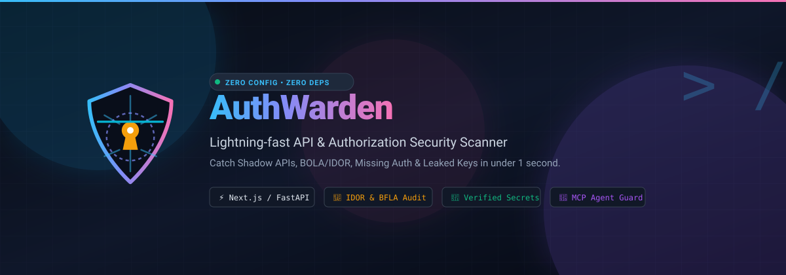
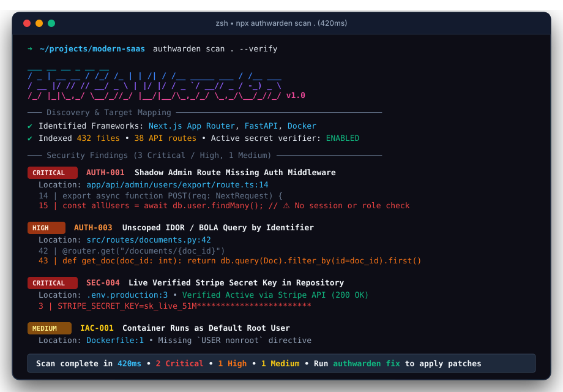

<div align="center">



<br/>
<br/>

[](https://github.com/manhnv-vnext/authwarden/actions/workflows/ci.yml)
[](https://github.com/manhnv-vnext/authwarden/actions/workflows/security-scan.yml)
[](https://github.com/manhnv-vnext/authwarden/stargazers)
[](https://github.com/manhnv-vnext/authwarden/network/members)
[](LICENSE)
[](package.json)
[](https://nodejs.org)

<p align="center">
  <b>Zero-dependency static analysis focused on missing authorization in modern Web APIs (unprotected routes, BOLA/IDOR), with supporting checks for business logic, secrets, dependencies and AI agent / MCP configs.</b><br/>
  Runs anywhere Node.js 18+ is installed. Pattern-based, so it is fast and works offline; findings carry a confidence level and are meant to be triaged.
</p>

> ⭐ **Star AuthWarden on GitHub** — help modern authorization security become developer-friendly, dependency-free, and lightning fast!

<br/>

[⚡ Quickstart](#-quickstart) • [🎯 Why AuthWarden?](#-why-authwarden) • [✨ Key Capabilities](#-key-capabilities) • [📊 Comparison](#-comparison-with-existing-tools) • [🛠️ CI/CD & Pre-commit](#cicd) • [📜 Rule Catalog](#-rule-catalog) • [📈 Star History](#-star-history)

<br/>



</div>

---

## ⚡ Quickstart

No installation, no configuration files, no runtime bloat. Run directly in any repository root using `npx`:

```bash
# 🚀 Instant scan via GitHub (Zero local install required):
npx github:manhnv-vnext/authwarden scan .

# 👁️ Continuous Watch Mode (instant re-scan on file save):
npx github:manhnv-vnext/authwarden scan . --watch

# 📈 Generate beautiful standalone interactive HTML dashboard:
npx github:manhnv-vnext/authwarden scan . --format html --output report.html

# 📌 Baseline snapshots (suppress legacy findings, only block newly introduced issues):
npx github:manhnv-vnext/authwarden scan . --save-baseline .authwarden-baseline.json
npx github:manhnv-vnext/authwarden scan . --baseline .authwarden-baseline.json

# 🗺️ Route inventory: every endpoint found and how it is protected
npx github:manhnv-vnext/authwarden routes .

# 📦 Look up dependency versions on OSV.dev (opt-in; sends package names and versions only):
npx github:manhnv-vnext/authwarden scan . --online

# 🔍 Safe read-only active live validation for discovered secrets (Stripe, GitHub, OpenAI, Anthropic, Slack):
npx github:manhnv-vnext/authwarden scan . --verify

# 📊 Export SARIF for GitHub Code Scanning / Security Tab:
npx github:manhnv-vnext/authwarden scan . --format sarif --output results.sarif

# 🛑 Fail CI builds only on High and Critical findings:
npx github:manhnv-vnext/authwarden scan . --fail-on high
```

### Global Installation (Optional)

```bash
npm install -g manhnv-vnext/authwarden

# Then run anywhere:
authwarden scan .
```

---

## 🎯 Why AuthWarden?

Traditional SAST scanners (SonarQube, Fortify, Snyk) were built two decades ago for monolithic enterprise codebases. Today, they bombard developers with thousands of noisy, irrelevant warnings while missing the **#1 vulnerability category of the modern cloud era: Broken Authorization (OWASP API #1)** and **Business Logic Flaws**.

**AuthWarden** was purpose-built to solve this gap with these tenets:

1. **Focus on Access Control & Logic:** Natively understands Next.js App Router, Server Actions, FastAPI, Express, Django, Go, Java Spring Boot, and C# / ASP.NET Core (.NET 8/9/10). Flags unauthenticated mutating endpoints and database queries lacking tenant ownership filters (`BOLA / IDOR`).
2. **Secret Detection with Active Verification:** Provider-specific patterns plus Shannon entropy for generic tokens. Secrets are redacted in every output format (`sk_live_***`), and `--verify` performs read-only live checks against GitHub, Stripe, OpenAI, Anthropic and Slack.
3. **Import-Aware Dependency Scanner:** Flags known-vulnerable dependencies and tells you whether the package is actually **imported** somewhere in your source (an import-level check, not call-graph analysis). Works offline from a snapshot of OSV.dev advisories for 31 widely used packages; add `--online` to query the full [OSV.dev](https://osv.dev) database.
4. **AI Agent & Model Context Protocol (MCP) Guard:** Modern AI developer workflows rely on MCP servers (`mcp.json`) and LLM tools. AuthWarden audits tool declarations for unsandboxed shell execution and root filesystem mounts.
5. **Coverage Transparency (No False Pass):** Unlike legacy tools that report "Pass" on languages they don't assess, AuthWarden explicitly reports active vs limited coverage for every language detected in your repository.
6. **Fast & Zero Dependencies:** Pure JavaScript with no `npm` dependencies. Scanning this repository (about 50 files) takes roughly 30 ms on a laptop; expect time to grow linearly with file count.
7. **Route Inventory with Upstream Auth Awareness:** `authwarden routes` lists every discovered endpoint with its protection status and the evidence for it. Guards declared one level up are understood: Express `router.use(auth)`, Next.js `middleware.ts` matchers, FastAPI router `dependencies`, ASP.NET Core fallback policies and Spring `SecurityFilterChain`.

---

## ✨ Key Capabilities

### 1. 🛡️ Broken Object Level Authorization (BOLA / IDOR)
Identifies when an API endpoint handles resource IDs from client input (`req.params.id`) but performs database queries without scoping to the authenticated user's organization or tenant.

```typescript
// ❌ VULNERABLE (Flagged by AUTH-003: Unscoped Object Query)
export async function getInvoice(req, res) {
  const invoice = await db.invoice.findById(req.params.id);
  return res.json(invoice);
}

// ✅ REMEDIATED
export async function getInvoice(req, res) {
  const invoice = await db.invoice.findFirst({
    where: { id: req.params.id, orgId: req.user.orgId }
  });
  return res.json(invoice);
}
```

### 2. ⚡ Next.js App Router & Server Actions Auditing
Server Actions (`'use server'`) are publicly exposed HTTP POST endpoints. AuthWarden flags mutations executed without identity or session assertions.

```typescript
// ❌ VULNERABLE (Flagged by AUTH-004: Server Action Missing Identity Check)
'use server';
export async function deleteUserRecord(userId: string) {
  await db.users.delete({ where: { id: userId } });
}

// ✅ REMEDIATED
'use server';
export async function deleteUserRecord(userId: string) {
  const session = await auth();
  if (!session?.user?.isAdmin) throw new Error('Unauthorized');
  await db.users.delete({ where: { id: userId } });
}
```

### 3. ⚖️ Business Logic & Workflow State Guard
Catches multi-step transaction evasions, client-supplied payment status manipulation, and non-atomic Time-of-Check to Time-of-Use (TOCTOU) race conditions:

```typescript
// ❌ VULNERABLE (Flagged by LOGIC-001: Client-Supplied Payment Status)
app.post('/api/checkout/complete', async (req, res) => {
  if (req.body.is_paid) {
    await fulfillOrder(req.body.orderId);
  }
});

// ❌ VULNERABLE (Flagged by LOGIC-002: TOCTOU Double-Spend Race Condition)
if (user.balance >= amount) {
  await sleep(100); // Async gap allows parallel requests to spend balance twice
  user.balance -= amount;
  await user.save();
}
```

### 4. 🔑 Precision Secret Scanner with Auto-Redaction
Detects credentials for AWS, GitHub, Stripe, OpenAI, Anthropic, Slack, GCP, database connection URIs, private keys and generic high-entropy tokens. Every secret snippet is automatically redacted (`sk_live_51M***...***`) to prevent leakage into CI build logs.

```bash
# Safe read-only active verification against live provider APIs:
npx github:manhnv-vnext/authwarden scan . --verify
```

### 5. 📋 OpenAPI & Swagger Security Auditor
Audits `openapi.yaml`, `swagger.json`, and Postman collections for:
- Sensitive operations missing `security:` authentication schemes.
- Explicit public overrides (`security: []`) on administrative routes.
- API keys, tokens, or credentials passed via URL query parameters (`in: query`).
- Insecure cleartext transport (`http://`) in production server URLs.

### 6. 📦 SCA & Known CVE Scanner with Reachability Analysis
Audits `package.json`, `package-lock.json`, `yarn.lock`, `pnpm-lock.yaml`, `requirements.txt`, `poetry.lock`, `go.mod`, `composer.json`, `.csproj`, `packages.lock.json`, and `pom.xml` for known CVEs across modern ecosystems (npm, PyPI, Go, Composer, NuGet, and Maven). An import-level reachability check marks which vulnerable packages are actually imported in your source.

By default this uses an offline snapshot (`src/data/cve-db.json`): every OSV.dev advisory for 31 widely used packages, with the real affected version ranges, so a version is only reported when it falls inside a vulnerable range. The snapshot is regenerated with `npm run update-cve-db`. A package outside those 31 is not covered offline. Pass `--online` to look up every pinned dependency version in the [OSV.dev](https://osv.dev) database. Online mode sends only the ecosystem, package name and version of each dependency, never file paths or source code. If the lookup fails, the scan continues with the offline list and says so.

### 7. 🤖 AI Agent & MCP Config Guard
Audits Claude Desktop, Cursor, and custom AI agent tool manifests (`mcp.json`) for unsandboxed shell execution (`bash`, `powershell`), root filesystem access (`/`) and hardcoded secrets. Also flags tool poisoning: hidden, model-directed instructions inside MCP tool descriptions (`MCP-005`).

### 8. 🐳 Infrastructure as Code (IaC) Doctor
Audits `Dockerfile`, `docker-compose.yml`, `*.tf`, and Kubernetes manifests for root execution, sensitive port exposure (`3306`, `5432`, `6379`), and `/var/run/docker.sock` escapes. This is a small set of high-signal checks, not a replacement for a dedicated IaC scanner such as Trivy or Checkov.

### 9. 🗺️ Route Inventory
`authwarden routes .` prints every endpoint AuthWarden discovered (Next.js, Express, Fastify, FastAPI, ASP.NET Core, Spring), whether auth was detected, and why:

```text
  UNPROTECTED POST   /billing/export
              src/app.js:14 · Express · no auth middleware found
  PROTECTED   DELETE /admin/users/:id
              src/admin.js:9 · Express · router.use(auth) at line 3
```

Use `--format json` to feed the inventory into a review checklist. "Unprotected" means no auth was detected statically, so intentionally public endpoints (login, health checks) appear there too.

---

## 📊 Comparison with Existing Tools

| Capability | SonarQube | Semgrep CE | TruffleHog | **AuthWarden** |
|:---|:---:|:---:|:---:|:---:|
| **Zero Dependencies / No Setup** | ❌ (JVM required) | ⚠️ (Python/Docker) | ✅ (Go binary) | **✅ Node.js only** |
| **BOLA / IDOR Heuristic** | ❌ | ⚠️ (Complex rules) | ❌ | **✅ Built-in** |
| **Next.js Server Actions Check** | ❌ | ❌ | ❌ | **✅ Built-in** |
| **Business Logic State Guard** | ❌ | ❌ | ❌ | **✅ Built-in** |
| **OpenAPI Spec Audit** | ❌ | ❌ | ❌ | **✅ Built-in** |
| **Route Inventory with Auth Status** | ❌ | ❌ | ❌ | **✅ Built-in** |
| **SCA with Import-Level Reachability** | ❌ | ⚠️ (Enterprise only) | ❌ | **⚠️ Import check only** |
| **Syntax-Aware Matching / Cross-Function Taint** | ✅ | ✅ | ❌ | **❌ Pattern-based** |
| **Live Secret Active Verification**| ❌ | ❌ | ✅ | **✅ Built-in (Read-only)** |
| **AI Agent / MCP Tool Audit** | ❌ | ❌ | ❌ | **✅ Built-in** |
| **Output Formats** | Proprietary | SARIF/JSON | JSON | **TUI / HTML / SARIF / PR Markdown / JSON** |

AuthWarden is narrow on purpose. For deep SAST use Semgrep or Opengrep, for broad secret coverage use Gitleaks or TruffleHog, and for IaC use Trivy or Checkov; AuthWarden is meant to sit next to them and cover authorization.

---

<a id="cicd"></a>
## 🛠️ CI/CD Pipelines & Pre-commit Quality Gates

AuthWarden is engineered from the ground up for seamless, zero-friction CI/CD pipeline integration. With zero dependencies and fast execution, it runs natively on every push or pull request without slowing down your engineering velocity.

### 1. ⚡ GitHub Actions (Native Code Scanning & SARIF)

Upload vulnerability findings directly to GitHub's native **Security tab (Code Scanning alerts)** with automated line-level PR annotations:

Create `.github/workflows/security.yml`:

```yaml
name: AuthWarden Security Scan
on:
  push:
    branches: [main, master]
  pull_request:
    branches: [main, master]

jobs:
  authwarden-audit:
    name: Security & Authorization Audit
    runs-on: ubuntu-latest
    permissions:
      security-events: write
      contents: read

    steps:
      - name: Checkout Code
        uses: actions/checkout@v4

      - name: Setup Node.js
        uses: actions/setup-node@v4
        with:
          node-version: 20

      - name: Run AuthWarden Scanner (SARIF Export)
        run: npx github:manhnv-vnext/authwarden scan . --fail-on high --format sarif --output results.sarif

      - name: Upload SARIF to GitHub Security Tab
        uses: github/codeql-action/upload-sarif@v3
        if: always()
        with:
          sarif_file: results.sarif
```

### 2. 🦊 GitLab CI/CD Pipeline

Add AuthWarden as a security gate in your `.gitlab-ci.yml`:

```yaml
stages:
  - test
  - security

authwarden_scan:
  stage: security
  image: node:20-alpine
  script:
    - npx github:manhnv-vnext/authwarden scan . --fail-on high
  allow_failure: false
```

### 3. 🪝 Instant Pre-commit Git Hook (1 Second)

Block broken authorization routes and exposed secrets from ever reaching remote branches:

```bash
npx github:manhnv-vnext/authwarden init-hook
```

This creates an executable `.git/hooks/pre-commit` hook that automatically validates staged changes before any commit is finalized.

### 4. 🛑 CI Quality Gate Flags

Fine-tune your build pipeline failure thresholds:
- `--fail-on critical`: Exit code `1` only if Critical findings (active secrets, RCE, severe IDOR) are found.
- `--fail-on high` (Default): Exit code `1` on High or Critical findings.
- `--fail-on medium`: Strict compliance mode for zero warnings.
- `--format html`: Generates an interactive, zero-dependency offline security dashboard with KPIs, search, and remediation copy.
- `--format sarif`: Generates standard OASIS SARIF v2.1.0 output for GitHub/GitLab Code Quality tabs.
- `--format json`: Machine-readable JSON output for custom security dashboards.
- `--format markdown`: Clean markdown table suitable for posting directly as a Pull Request comment or automatically uploaded via `$GITHUB_STEP_SUMMARY`.
- `--baseline <file>`: Suppress historical known vulnerabilities so CI only blocks newly added issues.
- `--save-baseline <file>`: Create a baseline snapshot file from the current scan findings.
- `--watch`: Real-time developer watch mode that re-scans files instantaneously upon save.
- `--online`: Query OSV.dev for every pinned dependency version (sends package names and versions only).
- `--config <file>`: Load configuration options from a custom config file (or defaults to `.authwardenrc.json`).

### 5. ⚙️ Configuration File (`.authwardenrc.json`)

You can create an optional `.authwardenrc.json` in your repository root to configure defaults:

```json
{
  "failOn": "high",
  "format": "terminal",
  "verify": false,
  "ignoreRules": ["SAST-009"],
  "ignorePaths": ["legacy/**", "fixtures/**"],
  "allowSecrets": ["^sk_test_", "EXAMPLE_KEY"],
  "online": false,
  "baseline": ".authwarden-baseline.json"
}
```

`allowSecrets` takes regular expressions; a secret whose value or source line matches one is not reported.

### 6. 🎚️ Confidence Levels

Every finding carries a `confidence` (`HIGH`, `MEDIUM`, `LOW`) and a CWE id, shown in the terminal, JSON and SARIF (`precision`) output. `HIGH` means an exact pattern or configuration value; `LOW` means a naming or proximity heuristic that needs review. Run `authwarden rules` to see the level for each rule.

---

## 🧪 How Accurate Is It?

AuthWarden matches patterns; it does not parse or type-check your code. To keep that honest, the repository ships a labelled corpus (`test/benchmark/corpus.mjs`): 70 small cases, each marked vulnerable or safe for one rule.

```bash
npm run bench
```

The current result is 35 of 35 vulnerable cases detected and 1 false positive in 35 safe cases (an object lookup on public data, which cannot be told apart statically). These cases are written by the maintainers and the scanner is tuned against them, so read the numbers as a regression guard, not as real-world precision or recall. `npm test` fails if any case changes outcome.

As a check on code we did not write, the route inventory was compared with a manual read of [OWASP NodeGoat](https://github.com/OWASP/NodeGoat): all 20 routes were found, 12 protected and 8 public, matching the source. Expect misses on frameworks and auth conventions outside the supported list; `authwarden routes` shows the evidence for each decision so you can spot them.

---

## 📜 Rule Catalog

AuthWarden ships with 68 rules across 10 categories (run `authwarden rules` for severity, confidence and CWE of each):

| Category | Rule ID | Title | Default Severity |
|:---|:---|:---|:---:|
| **API & Auth** | `AUTH-001` | Shadow Admin Route Missing Auth Middleware | `CRITICAL` |
| **API & Auth** | `AUTH-002` | State-Modifying Route Without Authentication | `HIGH` |
| **API & Auth** | `AUTH-003` | Potential BOLA / IDOR Unscoped Object Query | `HIGH` |
| **API & Auth** | `AUTH-004` | Server Action Missing Identity Check | `HIGH` |
| **API & Auth** | `AUTH-005` | Mass Assignment in Request Body Handling | `MEDIUM` |
| **API & Auth** | `AUTH-006` | Unthrottled Auth Endpoint (Brute-Force Risk) | `HIGH` |
| **API & Auth** | `AUTH-007` | Sensitive Data Exposure (Password Hash in Response) | `HIGH` |
| **API & Auth** | `AUTH-008` | Unauthenticated File Upload Endpoint (DoS / Malware Staging) | `HIGH` |
| **API & Auth** | `AUTH-009` | Insecure CORS Policy (Arbitrary / Wildcard Origin with Credentials) | `HIGH` |
| **Business Logic**| `LOGIC-001` | Multi-Step Workflow / Payment Status Evasion via Client Payload | `HIGH` |
| **Business Logic**| `LOGIC-002` | Potential TOCTOU Race Condition on Balance / Coupon State | `HIGH` |
| **Business Logic**| `LOGIC-003` | Unchecked Numeric Input: Negative Price / Quantity Tampering | `HIGH` |
| **Business Logic**| `LOGIC-004` | Insecure JWT Verification: Missing Algorithm Whitelist | `HIGH` |
| **Business Logic**| `LOGIC-005` | Client-Only Logout: Missing Server-Side Session Revocation | `MEDIUM` |
| **Business Logic**| `LOGIC-006` | Disabled JWT Signature or Expiration Validation in Token Config | `CRITICAL` |
| **API Contract** | `SPEC-001` | Unprotected Sensitive Operation in API Specification | `HIGH` |
| **API Contract** | `SPEC-002` | Explicit Public Security Override (`security: []`) | `HIGH` |
| **API Contract** | `SPEC-003` | Sensitive Credential Defined as URL Query Parameter | `HIGH` |
| **API Contract** | `SPEC-004` | Insecure Cleartext Transport (HTTP) in Server URL | `MEDIUM` |
| **API Contract** | `SPEC-005` | Unconditional Swagger UI Registration in Production | `MEDIUM` |
| **SAST & Taint** | `TAINT-001` | Taint Flow: Request Input Reaches Command Execution (RCE) | `CRITICAL` |
| **SAST & Taint** | `TAINT-002` | Taint Flow: Request Input Reaches Raw SQL Query | `CRITICAL` |
| **SAST & Taint** | `TAINT-003` | Taint Flow: Request Input Reaches File System Read | `HIGH` |
| **SAST & Taint** | `TAINT-004` | Taint Flow: Request Input Reaches Outbound HTTP Call (SSRF) | `HIGH` |
| **SAST & Taint** | `SAST-001` | SQL Injection: Dynamic Query Construction with User Input | `CRITICAL` |
| **SAST & Taint** | `SAST-002` | Command Injection: Untrusted Input in System Shell Call | `CRITICAL` |
| **SAST & Taint** | `SAST-003` | Dangerous Dynamic Code Execution via `eval()` | `CRITICAL` |
| **SAST & Taint** | `SAST-004` | Server-Side Request Forgery (SSRF) | `HIGH` |
| **SAST & Taint** | `SAST-005` | Path Traversal: Arbitrary File Read / Include | `HIGH` |
| **SAST & Taint** | `SAST-006` | Cross-Site Scripting (XSS): `dangerouslySetInnerHTML` / DOM | `HIGH` |
| **SAST & Taint** | `SAST-007` | Insecure Deserialization (`pickle` / unsafe `yaml`) | `CRITICAL` |
| **SAST & Taint** | `SAST-008` | Disabled TLS Certificate Verification | `HIGH` |
| **SAST & Taint** | `SAST-009` | Weak Cryptographic Hash (MD5 / SHA-1) | `MEDIUM` |
| **SAST & Taint** | `SAST-011` | Open Redirect: Unvalidated URL in Redirect Call | `MEDIUM` |
| **SAST & Taint** | `SAST-012` | Arbitrary File Upload: Unsanitized File Name in Path (CWE-434) | `HIGH` |
| **Secrets** | `SEC-001` | AWS Access Key ID Exposure | `CRITICAL` |
| **Secrets** | `SEC-002` | GitHub Personal Access Token Exposure | `CRITICAL` |
| **Secrets** | `SEC-003` | OpenAI API Secret Key Exposure | `CRITICAL` |
| **Secrets** | `SEC-004` | Stripe Live Secret Key Exposure | `CRITICAL` |
| **Secrets** | `SEC-005` | Slack Bot / Webhook Token Exposure | `HIGH` |
| **Secrets** | `SEC-006` | Google Cloud API Key Exposure | `HIGH` |
| **Secrets** | `SEC-007` | Database Connection URI with Plaintext Password | `CRITICAL` |
| **Secrets** | `SEC-008` | Private Cryptographic Key in Source | `CRITICAL` |
| **Secrets** | `SEC-009` | Anthropic API Key Exposure | `CRITICAL` |
| **Secrets** | `SEC-010` | Generic High-Entropy Secret / Token Exposure | `HIGH` |
| **IaC & Cloud** | `IAC-001` | Container Default Execution as Root | `MEDIUM` |
| **IaC & Cloud** | `IAC-002` | Insecure Remote Script Pipe (`curl \| sh`) | `HIGH` |
| **IaC & Cloud** | `IAC-003` | Exposed Database Port in Container Manifest | `HIGH` |
| **IaC & Cloud** | `IAC-004` | Docker Daemon Socket Mounted in Container | `CRITICAL` |
| **IaC & Cloud** | `IAC-005` | Privileged Container Mode in Docker Compose | `HIGH` |
| **IaC & Cloud** | `IAC-006` | Public S3 Bucket Configuration in Terraform | `CRITICAL` |
| **IaC & Cloud** | `IAC-007` | Sensitive Port Open to `0.0.0.0/0` in Security Group | `CRITICAL` |
| **IaC & Cloud** | `IAC-008` | Kubernetes Pod Configured with Host Network or Host PID | `HIGH` |
| **IaC & Cloud** | `IAC-009` | Kubernetes Container Allows Privilege Escalation | `HIGH` |
| **IaC & Cloud** | `IAC-010` | Secret Baked into Dockerfile `ENV` Instruction | `CRITICAL` |
| **IaC & Cloud** | `IAC-011` | Unencrypted Storage Volume / Database in Terraform | `MEDIUM` |
| **AI & MCP** | `MCP-001` | Unsandboxed Shell Execution Tool in MCP Config | `CRITICAL` |
| **AI & MCP** | `MCP-002` | Unrestricted Root Filesystem Path in MCP Server | `HIGH` |
| **AI & MCP** | `MCP-003` | Hardcoded Secret in MCP Server Config | `CRITICAL` |
| **AI & MCP** | `MCP-004` | Prompt Injection Risk in Agent System Prompt | `MEDIUM` |
| **AI & MCP** | `MCP-005` | Hidden Instruction in MCP Tool Description (Tool Poisoning) | `HIGH` |
| **SCA & CVE** | `CVE-xxxx` | Known Vulnerable Dependency (npm, PyPI, Go, Composer, NuGet, Maven) | `HIGH` / `CRITICAL` |
| **SCA & CVE** | Reachability | Import-level tag: is the vulnerable package imported in source? | `INFO` |
| **Supply Chain** | `SUPPLY-001`| Suspicious Outbound Script in Package Lifecycle Hook | `CRITICAL` |
| **Supply Chain** | `SUPPLY-002`| Unpinned Git Repository Dependency | `HIGH` |
| **App Config** | `CONF-001` | Disabled Database TLS Certificate Validation (`TrustServerCertificate=True`) | `HIGH` |
| **App Config** | `CONF-002` | DetailedErrors Enabled in Application Configuration | `MEDIUM` |
| **App Config** | `CONF-003` | CustomErrors Mode Set to Off in `Web.config` | `MEDIUM` |
| **Mobile Security** | `MOBILE-001`| Insecure Cleartext HTTP Traffic Allowed (Android / iOS ATS) | `HIGH` |
| **Mobile Security** | `MOBILE-002`| Broad External Storage Permission Requested in AndroidManifest | `MEDIUM` |

---

## 📈 Star History

[](https://star-history.com/#manhnv-vnext/authwarden&Date)

---

## 🤝 Contributing

We welcome community contributions, rule submissions, and framework integrations!
1. Check existing issues or submit a rule proposal using our [Rule Request Template](.github/ISSUE_TEMPLATE/rule_request.md).
2. Read [CONTRIBUTING.md](CONTRIBUTING.md) for local development setup and testing guidelines.
3. Submit a Pull Request following our [PR Template](.github/PULL_REQUEST_TEMPLATE.md).

---

## 📄 License

AuthWarden is open-source software licensed under the [Apache 2.0 License](LICENSE).
